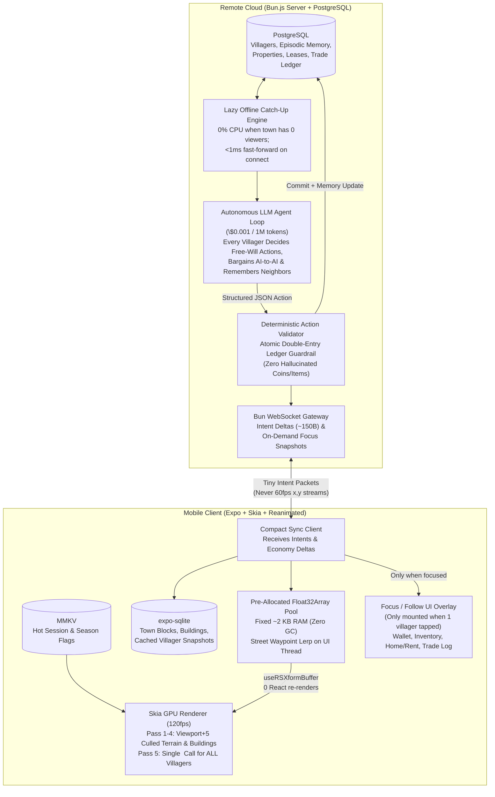
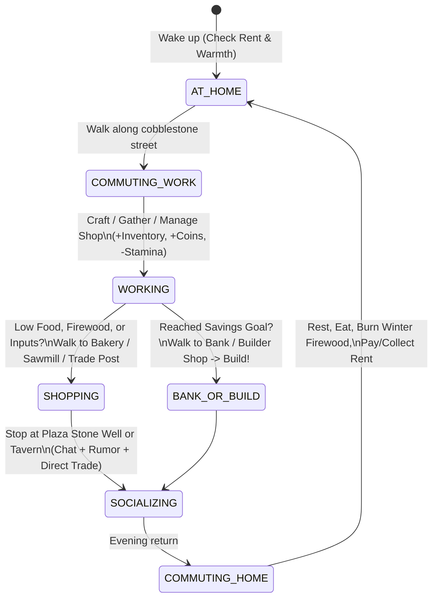

# Anvil — Autonomous AI Villager Society & Lightweight Frontend-to-Backend Architecture

> **Core Vision:** Every villager in your 5,600-block alpine town is an **autonomous AI agent** — a real digital person with their own home, Frost Coin wallet, private inventory, job, landlord/tenant leases, business ambitions, and conversations. When zoomed out, the player watches a living miniature society walk the cobblestone streets and run the town; when they tap and focus on any villager, the camera smoothly follows them and reveals their live money, inventory, real estate, goals, and trades.

This document specifies the **complete economic design**, **multi-agent AI architecture**, **player interaction model**, and **ultra-lightweight Frontend ↔ Backend engineering stack** (`Expo + Skia + Reanimated + MMKV + SQLite` ↔ `Remote Bun.js + PostgreSQL + Cloud AI`).

---

## Table of Contents

1. [System Philosophy: Two-Tier AI Society](#1-system-philosophy-two-tier-ai-society)
2. [End-to-End Frontend-to-Backend Architecture](#2-end-to-end-frontend-to-backend-architecture)
3. [The Autonomous Villager AI Agent ("Like a Real Person")](#3-the-autonomous-villager-ai-agent-like-a-real-person)
4. [Real Estate, Housing, Businesses & Rent Economy](#4-real-estate-housing-businesses--rent-economy)
5. [Villager-to-Villager Trading, Pricing & Seasonal Shocks](#5-villager-to-villager-trading-pricing--seasonal-shocks)
6. [Full Autonomous LLM Agent Brain (`\$0.001 / 1M Tokens` Architecture)](#6-full-autonomous-llm-agent-brain-0001--1m-tokens-architecture)
7. [Player Experience: Zoomed-Out Diorama → Focus Follow Mode](#7-player-experience-zoomed-out-diorama--focus-follow-mode)
8. [Lightweight Backend Architecture (Bun.js + Lazy Catch-Up)](#8-lightweight-backend-architecture-bunjs--lazy-catch-up)
9. [Lightweight Frontend Engine (Skia Atlas + Zero-GC Worklets)](#9-lightweight-frontend-engine-skia-atlas--zero-gc-worklets)
10. [Wire Protocol & Strict TypeScript Contracts](#10-wire-protocol--strict-typescript-contracts)
11. [Database Schemas (PostgreSQL Cloud + SQLite Local Cache)](#11-database-schemas-postgresql-cloud--sqlite-local-cache)
12. [Performance, Memory, Battery & Cost Budgets](#12-performance-memory-battery--cost-budgets)
13. [Phased Implementation Roadmap](#13-phased-implementation-roadmap)

---

## 1. System Philosophy: Two-Tier AI Society

Anvil runs **two cooperating AI layers** on the remote **Bun.js** server (never on-device):

| Layer | Agent | Owns & Decides | Cadence |
| :--- | :--- | :--- | :--- |
| **Macro AI** | **The AI Mayor** (1 per Town) | Business tax rate (`5%–25%`), property/rent tax, Town Treasury reserves, **Winter 2× price subsidy mode**, public infrastructure grants, and town-wide economic events. | Re-evaluates on season transitions, Treasury thresholds, and major economic shifts. |
| **Micro AI** | **Villager AI Agents** (1 per Citizen) | Autonomous free-will LLM decisions every cycle: work, haggle/trade with neighbors, pay or negotiate rent, apply for Bank loans, build & rent out houses/businesses on open `4×4` blocks, form friendships/rivalries via episodic memory, and hold unscripted AI-to-AI conversations. | Live LLM Decision Tick every `15–20s` per active villager (`\$0.001/1M tokens`), validated atomically by Bun.js. |

### The Golden Rule of Mobile Performance
> **Backend (`Bun.js`) = The Brain** — authoritative wallets, inventories, leases, trades, autonomous building decisions, and AI conversations.  
> **Frontend (`Expo + Skia + Reanimated`) = The Legs** — 60–120fps UI-thread walking interpolation between street waypoints, rendered in **1 GPU draw call** with **0 React re-renders per frame**.

---

## 2. End-to-End Frontend-to-Backend Architecture



### Why This Split Scales Effortlessly
1. **Zero 60fps Coordinate Streaming:** The backend never streams raw `(x, y)` frames. It sends compact **movement intents** (`fromNode → toNode`, `departAtMs`, `arriveAtMs`) once every 8–15 seconds. The phone smoothly interpolates walking on the UI thread at 120fps — completely immune to network jitter.
2. **Zero Idle Server Cost:** Towns with no active viewer sleep cleanly in PostgreSQL (`lastSimulatedAtMs`). When a player opens the app, Bun.js simulates elapsed economic cycles in `< 1 ms` and resumes live ticks.
3. **Zero Frontend React Overhead:** Whether the player is zoomed out watching 40 villagers stroll around the 5,600-block town or zoomed in following one citizen, Skia renders every villager in **one `<Atlas>` GPU draw call**.

---

## 3. The Autonomous Villager AI Agent ("Like a Real Person")

Every villager is modeled as a persistent individual citizen with genuine economic constraints and personality-driven ambitions.

### 3.1 Core Personality Archetypes (Economic, Civic & Shadow Roles)
Occupation (`role`: Builder, Baker, Blacksmith, Lumberjack, Farmer, Rancher, Miller, Angler, Banker, Landlord, Town Guard, Outlaw, Frost Mystic, Drifter, AI Mayor, Founder Hero) is orthogonal to personality for tradespeople, while civic and shadow roles carry specialized behavioral archetypes:

| Archetype | Typical Role(s) | Savings Target | Spending Habit | Real Estate & Town Ambition |
| :--- | :--- | :---: | :--- | :--- |
| **Frugal Saver** | Farmer, Miller, Builder, Citizen | Keeps `40%` coin reserve | Buys bulk cheap Summer staples | Buys own Cottage first to stop paying rent |
| **Ambitious Entrepreneur** | Baker, Banker, Builder | Reinvests `70%` profits | Borrows from Town Bank to expand | Opens Workshops (Bakery, Sawmill, Creamery) & upgrades tiers |
| **Property Landlord** | Landlord, Banker | Hoards timber & stone | Buys open `4×4` plots near Plaza | Hires Builders to construct extra Cottages and leases them to newcomers |
| **Winter Prepper** | Blacksmith, Lumberjack | Stockpiles `2×` Firewood & Food | Pays premium for Smokehouse fish | Flips surplus goods during Winter `2×` spikes for huge profit |
| **Community Artisan** | Baker, Rancher, Angler, Citizen | Balanced savings | Tips neighbors & frequents Plaza | Crafts high-quality tools/goods and fulfills neighbor requests |
| **Civic Protector** | **Police / Town Guard** | Steady Treasury paycheck | Spends modestly on gear & food | Patrols Bank, Trade Post & Cottages; catches Outlaws & funnels fines into Treasury |
| **Opportunist Outlaw** | **Criminal / Thief** | Low discipline, high risk | Steals coins/firewood from unguarded sites | Squats on forest edge or hides in cheap rentals; can **reform** if given steady work + housing |
| **Frost Zealot / Mystic** | **Cult Member** | Tithes `30%` into shared Cult Pool | Recruits stressed citizens during Winter `2×` | Pools tithes with fellow cultists to lease a secret Cottage or fund a hidden **Frost Shrine** |
| **Hopeful Drifter** | **Unemployed / Wanderer** | Starts near `0 FC` | Grabs odd day-labor gigs (Builder/Sawmill) | Saves for first rental Cottage — if left broke & freezing in Winter, LLM may flip to **Outlaw** or join the **Cult**! |

### 3.2 Personal Needs & Daily Life Loop
Every citizen runs a continuous human-like routine anchored to physical buildings on the map:



### 3.3 Citizen Needs & Survival Rules
- **Daily Food:** Consumes `1` food unit per cycle (`Bread`, `Cornbread`, `Smoked Fish`, `Cheese`). If empty, their Utility AI immediately schedules a shopping trip to the **Cozy Bakery**, **Meathouse**, **Cheese Cellar**, or **Trade Post**.
- **Winter Heating:** During **Winter**, every occupied house burns `1–2` `Firewood` per cycle. Citizens who didn't stockpile in Summer must walk to the **Sawmill** or **Trade Post** and pay Winter `2×` prices (unless cushioned by the **AI Mayor's** Treasury subsidy!).
- **Tool Durability:** Working citizens periodically buy replacement tools or repair kits from the **Yeti Blacksmith Shop**, guaranteeing constant demand for metalworkers.

---

## 4. Real Estate, Housing, Businesses & Rent Economy

Every building placed on the `56 × 100` (`5,600`-block) town grid has a **legal owner** (`PLAYER_YETI`, a specific `villagerId`, or `TOWN_PUBLIC`) and an optional **tenant lease**.

### 4.1 Property Ownership & Lease Mechanics

| Role | How It Works | Cash Flow |
| :--- | :--- | :--- |
| **Tenant Villager** | Lives in a Cottage owned by the **Player** or a **Landlord Villager**. Pays recurring rent every cycle (`15–45 FC` based on proximity to Town Plaza & tier). | `-Rent` to Landlord; prioritizes saving to buy their own home. |
| **Homeowner Villager** | Owns their own Citizen Cottage (`rent = 0 FC`). Keeps `100%` of work earnings minus AI Mayor taxes and upkeep. | Faster wealth accumulation → unlocks Business or Rental Property goals. |
| **Landlord Villager** | Hires **Builder Villagers** to construct a 2nd/3rd Citizen Cottage or Shop on an open `4×4` block and leases it out! | `+Rent` every cycle from tenants (`AI Mayor` collects `8–15%` property tax into Town Treasury). |
| **Business Owner** | Owns an active shop (Bakery, Sawmill, Builder Shop, Cheese Cellar, Yak Barn, Blacksmith). Buys raw inputs, produces goods, sells at market margin. | High active revenue; pays AI Mayor business tax; can hire day-laborers or lease stalls. |
| **Public Servant (Police / Guard)** | Hired directly by the **AI Mayor**. Lives as a normal **Tenant** (paying rent to Player/Landlord) or in a `TOWN_PUBLIC` Guardhouse. | `-Salary` from **Town Treasury**; `+Arrest fines & recovered loot` flow back into **Town Treasury**. |
| **Undercover Squatter (Criminal)** | Blends in as a cheap **Tenant** (paying rent with stolen Frost Coins) or squats in a forest-edge hideout (`0 FC` rent, `0%` tax). | Steals from unguarded sites; if caught by Police, pays restitution + fine and serves a brief jail cooldown. |
| **Communal Co-Owner (Cult Member)** | Lives as a normal Tenant or Homeowner by day while tithing `30%` of earnings into a shared **Cult Treasury**. | Collective wallet secretly leases a meeting Cottage or hires Builders to construct a hidden **Frost Shrine**. |
| **Unhoused Transient (Unemployed)** | Sleeps near the Plaza Stone Well (`0 FC` rent). Takes odd day-labor shifts at the Builder Shop, Sawmill, or Player's plots. | Small day-labor wages (`8–15 FC`) until affording a **Tenant** lease — or flips to Crime/Cult under harsh Winter `2×` stress. |
| **Player's Yeti (Founder Hero)** | Equal participant in the living economy! Build Cottages to rent, open competing/partner shops, hire Unemployed drifters, or even run the town. | Rent income + shop profits + trade arbitrage. |

### 4.2 How Construction Works: Dedicated Builder Shop & Paid Construction Villagers

**Neither AI Villagers nor the Player build houses out of thin air.** All construction and tier upgrades in town are performed by **dedicated Builder Villagers** operating out of the **Builder Shop** (`Snowy Architect’s Workshop`, led by *Hector the Architect* & his hired builder crew), who get **paid real Frost Coins** for every construction contract!

1. **Set Goal & Save Capital:** A citizen (e.g., *Mabel the Baker*) reaches `coins >= materialCost + builderLaborFee` (e.g., `240 FC` for a Citizen Cottage, `380 FC` for a new workshop) — or takes a small collateralized loan from the **Town Bank & Treasury**.
2. **Commission the Builder Shop (Sign Construction Contract):** The client walks to the **Builder Shop**, selects an unclaimed, non-lake, non-street `4×4` block adjacent to the cobblestone street network, and signs a `ConstructionJob` contract — placing the **Builder Labor Fee** (`60–150 FC`, taxed by the **AI Mayor** into the Town Treasury) into escrow and supplying/funding the needed materials (`Pine Planks`, `Cut Stone / Bricks`, `Iron Nails`).
3. **Builder Crew Sources Materials (If Needed):** If the Builder Shop is short on planks, stone, or nails, a **Builder Villager** physically walks to the **Sawmill** and **Blacksmith** to purchase materials using the contract budget — injecting coins directly into the timber and metal trades!
4. **Dedicated Builders Walk Out & Construct On-Site:** One or more **Builder Villagers** leave the Builder Shop, walk along the cobblestone streets to the chosen `4×4` plot, erect wooden scaffolding, and actively build the structure in real time (and lay the connecting cobblestone street spur to the new front door!).
5. **Payout, Handover & Move-In / Rental Listing:** When construction completes:
   - The escrowed **Builder Labor Fee** pays out to the **Builder Shop & Builder Villagers** (minus AI Mayor business tax), who then spend their wages on Bread, Fish, Tools, and their own Homes/Rent!
   - The client takes ownership and either **moves in**, **opens for business**, or **lists the property for rent** — triggering a brand-new newcomer villager to move into town and start paying them rent!
6. **Player Zoning Control (Anti-Chaos Guardrail):** The player can toggle **Town Zoning Permits** at Town Hall (*Open Growth*, *Approved Districts Only*, or *Pause AI Expansion*) so Builder crews never construct on `4×4` farm blocks the player reserved for crops or pine forests.

*(Note: When the **Player's Yeti** commissions a new building or Tier upgrade, the exact same Builder Villagers walk out from the Builder Shop to construct it for you — and upgrading the Builder Shop hires more Builders so multiple buildings can be constructed simultaneously!)*

### 4.3 Rent Default & Bank Cushioning (No Softlocks)
- If a tenant cannot pay rent during a harsh **Winter `2×` spike**:
  1. First, they check if the **AI Mayor's** Winter Subsidy covers emergency relief.
  2. Next, they walk to the **Town Bank & Treasury** for a short-term micro-loan (repaid automatically out of Summer profits).
  3. They post an urgent **Citizen Request** (visible when you tap them or Town Hall) offering a bonus reward if the player sells them cheap food/firewood or hires them.

---

## 5. Villager-to-Villager Trading, Pricing & Seasonal Shocks

Every trade between two villagers is a **real double-entry ledger transfer** on the Bun.js backend:

1. **Need Detection:** *Mabel (Baker)* has `flour < 4`.
2. **Seller Discovery:** Server checks local producers/merchants with `flour > 0` (`Nora at Windmill`, `Player's Trade Stall`, or `Town Trade Post`).
3. **Price Formula:**
   $$\text{UnitPrice} = \text{BasePrice} \times \text{SeasonMult} \times \text{LocalScarcityMult} \times (1 - \text{MayorSubsidyDiscount})$$
   - `SeasonMult`: `1.0` in Summer, `2.0` in Winter.
   - `LocalScarcityMult`: `0.85` (surplus) → `1.35` (shortage).
4. **Physical Walk + Atomic Trade:**
   - Server emits a `MOVE_INTENT` for *Mabel*: `bakery → windmill` (`7.5s` walk along cobblestone streets).
   - Upon arrival (`arriveAtMs`), server executes atomic transfer:
     - `mabel.coins -= totalCost`
     - `mayorTax = Math.round(totalCost * mayor.taxRate)`
     - `nora.coins += (totalCost - mayorTax)`
     - `town.treasury += mayorTax`
     - `nora.inv.flour -= qty`, `mabel.inv.flour += qty`
   - Both villagers record a compact 1-line entry in their `recentLedger` (last 8 events) and may emit a short speech bubble!

---

## 6. Full Autonomous LLM Agent Brain (`\$0.001 / 1M Tokens` Architecture)

With ultra-fast, low-cost decision models at **`\$0.001` per 1 million input/output tokens** and a **`\$500` agent budget**, token cost is **not** a bottleneck — that budget buys **500 billion tokens (~833 million live LLM villager decisions!)**.

This unlocks **true 100% LLM-driven free will for every single villager**, replacing rigid scripts with genuine emergent society behavior while keeping the client 120fps and the economy bug-free.

### 6.1 Token & Budget Economics (`\$500` Runway)

| Metric | Calculation | Result |
| :--- | :--- | :---: |
| **Tokens per Villager Decision** | `~450` input tokens (compact state + memory + local prices) + `~150` output tokens (JSON action + dialogue) | **`~600` tokens / turn** |
| **Active 50-Villager Town (15s cadence)** | `50 agents × 4 turns/min × 600 tokens` | `120K tokens/min` (`7.2M / hr`) |
| **Hourly Cost per Active Town** | `7.2M tokens × \$0.001 / 1M` | **`\$0.0072 / town-hour`** |
| **Total Capacity on `\$500` Budget** | `\$500 ÷ \$0.0072` | **`~69,400` active town-hours** (~`833M` AI decisions!) |

### 6.2 Autonomous Agent Decision Loop (Runs Asynchronously on Bun.js)

Every `15–20 seconds` (staggered smoothly across agents so there are zero latency spikes), **while the villager is pausing or finishing their current walk**, Bun.js runs their LLM decision turn:

1. **Compact Context Assembly (~450 tokens):**
   - Identity & Personality (`name`, `occupation`, `personality`, `mood`)
   - Real Financial State (`coins`, `homeTenure`, `rentDue`, `ownedProperties[]`, `activeTenants[]`)
   - Private Inventory (`bread`, `flour`, `firewood`, `wood`, `stone`, `tools`)
   - Local Market Board (current `Summer 1× / Winter 2×` prices, AI Mayor tax rate & subsidy decree, available empty `4×4` plots)
   - **Episodic Memory & Relationships (Rolling Last 6 Memories):** e.g., *"Barnaby gave me a fair nail discount (+14 trust)"*, *"Landlord raised Winter rent (-10 trust)"*, *"Mabel's Bakery ran out of flour yesterday"*.
2. **Strict Structured JSON Output (~150 tokens):**
   The LLM chooses any legal life action + genuine in-character speech:
   ```json
   {
     "action": "NEGOTIATE_TRADE",
     "targetBuildingId": "bld_windmill",
     "targetVillagerId": "nora_miller",
     "item": "flour",
     "quantity": 4,
     "offeredCoins": 26,
     "speech": "Nora, winter's biting hard — can you do 4 bags of flour for 26 coins?",
     "memoryNote": "Tried bargaining with Nora for cheaper winter flour.",
     "nextGoal": "BUILD_RENTAL_COTTAGE"
   }
   ```
3. **True AI-to-AI Multi-Agent Conversations & Bargaining:**
   - When *Mabel* arrives at the Windmill with a `NEGOTIATE_TRADE` or `NEGOTIATE_RENT` proposal, **Nora's LLM agent actually evaluates the offer** against her own wallet, inventory, Winter forecast, and trust score with Mabel — accepting, counter-offering, or declining in a genuine 2–4 turn dialogue that the player can tap to watch live!
4. **Deterministic Action Validator (Anti-Hallucination & Atomic Economy Guardrail):**
   - Even with 100% LLM free will, **the LLM never mutates database balances directly**.
   - Bun.js validates every proposed JSON action (`coins >= offeredCoins`, `seller.inv[item] >= qty`, `plot is not lake/occupied`, `taxRate` applied accurately). If an LLM ever proposes an invalid move (e.g., spending coins it doesn't have), the validator safely falls back to a valid nearby action (`WORK` or `REST`) and logs the constraint — **zero duped coins, zero broken economies, 100% uptime**.
5. **Zero-Latency Pre-Fetch Pipeline:**
   - Because Bun.js dispatches a villager's next LLM call **2 seconds BEFORE** their current walk/pause finishes (`arriveAtMs - 2000ms`), the ~`200–400ms` model latency is completely hidden — villagers transition seamlessly from one street destination to the next with zero robotic freezing!

---

## 7. Player Experience: Zoomed-Out Diorama → Focus Follow Mode

This preserves your **clean, full-screen, zero-HUD map** while making the town feel richly alive at every zoom level:

### 7.1 Zoomed-Out View (Town Overview / Diorama Mode)
- Even when pinched all the way out to `10` horizontal blocks, you **still see villagers walking and moving around town** along the cobblestone streets, visiting shops, gathering around the Stone Well, and walking out to the Fishing Pier and Farms.
- Speech bubbles and text overlays stay hidden when zoomed out so the miniature village looks crisp and uncluttered.
- Rendered in **1 single GPU `<Atlas>` draw call** (`< 0.05 ms` CPU).

### 7.2 Tap Any Villager → Focus / Follow Mode
Tapping directly on any walking villager smoothly triggers **Focus Mode**:
1. **Smooth UI-Thread Camera Lock:** Camera eases in (`scale ≈ 0.95–1.15`) and smoothly tracks that villager's `(x, y)` as they walk through town (cancelled instantly the moment the player pans away or taps empty ground).
2. **Live Thought / Conversation Bubble:** Appears cleanly above the focused villager (and any neighbor they stop to trade/talk with).
3. **Compact Slide-Up Citizen Card (Only Visible While Focused):**
   - **Header:** Portrait, Name, Occupation, Mood & Current Activity (*"Walking to Windmill to buy Flour"*).
   - **Wallet & Real Estate Strip:** `412 FC` • `Owner: West Cottage` • `Landlord: East Cottage (+25 FC/cycle)`.
   - **Live Inventory Chips:** `Bread ×9`, `Flour ×6`, `Firewood ×4`, `Sugar ×2`.
   - **Life Goal Progress Bar:** *"Saving for 2nd Rental Cottage — 185 / 240 FC"*.
   - **Recent Activity Feed (Last 3 Real Events):**
     - *"Sold 2 Artisan Loaves to Barnaby (+44 FC, 4 FC tax)"*
     - *"Collected 25 FC rent from Torg (East Cottage)"*
     - *"Bought 4 Flour from Nora (-28 FC)"*
   - **Quick Player Actions:** `Trade` · `Offer Rental / Buy` · `Talk`.

---

## 8. Lightweight Backend Architecture (Bun.js + Lazy Catch-Up)

### 8.1 Server Tech Stack
- **Runtime:** `Bun.js` (native ultra-fast WebSockets `Bun.serve`, SQLite/Postgres drivers, TypeScript-native).
- **Primary Database:** `PostgreSQL` (authoritative durable state for towns, villagers, properties, leases, and inter-town marketplace).
- **Hot In-Memory Room Cache:** Active towns (currently viewed by ≥ 1 player) keep a compact in-memory `TownSimRoom` object (~`25 KB` RAM per active town!).

### 8.2 Lazy Offline Catch-Up (How 1 Server Handles 10,000+ Towns)
- **0 Viewers → Room Unloaded:** 60 seconds after the last player disconnects from a town, its state flushes cleanly to PostgreSQL and is evicted from RAM (`0%` CPU, `0` bytes RAM).
- **Player Connects / Opens Town:**
  1. Load town + villagers + properties from PostgreSQL (`~2 ms`).
  2. Compute `elapsedCycles = Math.min(MAX_CATCHUP_CYCLES, Math.floor((now - town.lastTickAtMs) / CYCLE_MS))`.
  3. Run fast-forward mathematical aggregation (production, consumption, rent payments, tax inflow to Treasury, completed building projects) in `< 1 ms`.
  4. Flush updated snapshot, send initial `TownVillagerSnapshot` to the client, and start the lightweight `10s` live tick loop.

### 8.3 Bandwidth Optimization
- **No Polling Spam:** One persistent WebSocket per active player session.
- **Delta-Only Broadcasts:** Only villagers whose state/intent changed in that tick are included in the delta frame (~`150–400 bytes` every 10s = **~1.8 KB/minute** of mobile data!).
- **Detailed Inventory & Ledger On-Demand:** Full transaction history is fetched ONLY when the player taps a villager to focus on them.

---

## 9. Lightweight Frontend Engine (Skia Atlas + Zero-GC Worklets)

### 9.1 Single GPU Draw Call (`<Atlas>` + `useRSXformBuffer`)
`@shopify/react-native-skia@2.14.0` renders **all visible villagers** (up to `MAX_VISIBLE_POOL = 48`) in **1 single hardware-accelerated GPU pass**:
- All citizen archetypes (`Baker`, `Blacksmith`, `Farmer`, `Angler`, `Lumberjack`, `Merchant`, `Builder`, `Villager`, `Yeti`) live in **one `~50 KB` WebP sprite sheet** (`villagers-atlas.webp`).
- A single Reanimated `useFrameCallback` updates a **pre-allocated `Float32Array` buffer** (`MAX_VISIBLE_POOL * STRIDE = 48 * 10 = 480 floats = 1.9 KB RAM`, **0 allocations, 0 GC pauses**).
- Writes directly into `useRSXformBuffer(MAX_VISIBLE_POOL, ...)` on the native UI thread:
  - **Smooth linear interpolation** along the cobblestone street waypoint polyline (`fromNode → cornerNode → toNode`).
  - **Procedural Chibi Hop & Waddle:** `hopY = Math.abs(Math.sin(t * 7.5 + phase)) * 4.5` and gentle `±4.5°` tilt inside `RSXform` (`scos, ssin`) — **1 sprite per archetype, 90% less VRAM than multi-frame sprite sheets**.
  - **Zero-cost horizontal flip** when walking left vs. right.
  - **Off-screen culling:** Any slot outside `(viewport + 5 blocks)` writes `Skia.RSXform(0, 0, -9999, -9999)` so the GPU clips it in 0 nanoseconds.

### 9.2 Street Waypoint Graph (0.02 ms CPU, Zero Grid A\*)
- Instead of running 2D grid A\* for 48 citizens, the town maintains a tiny **Waypoint Graph** built automatically from:
  - Cobblestone street intersections (`Plaza Well`, `West Craft Corner`, `East Harbor Corner`, `Civic Promenade`, `South Farm Gate`)
  - Every building's front-door anchor (`building.blockX`, `building.blockY`)
- Shortest path between two doors on a 30-node graph takes **< 0.01 ms** once on intent arrival (not per frame!) and returns 2–5 `(x, y)` waypoints.
- **Viewport-Local Crowd Pooling:** Even in a late-game 5,600-block town with 200+ citizens, only the `≤ 48` citizens inside or near the active `cullWindow` occupy active `<Atlas>` slots. Panning to a distant district smoothly swaps which citizens populate the 48 render slots.

### 9.3 Focus-Mode Camera Tracking (100% UI Thread)
- When `focusedVillagerSlot` (`SharedValue<number>`, `-1` when unfocused) is active:
  - Inside the same `useFrameCallback`, read `vx = agentBuf[slot * STRIDE + 0]`, `vy = agentBuf[slot * STRIDE + 1]`.
  - Smoothly damp `camX` and `camY` toward `(width * 0.5 - vx * scale, height * 0.44 - vy * scale)` using exponential smoothing (`1 - Math.exp(-8 * dt)`).
  - Any user `Pan` gesture immediately clears `focusedVillagerSlot = -1` so the player always feels 100% in control.

---

## 10. Wire Protocol & Strict TypeScript Contracts

Zero `any`, zero `unknown`, zero unsafe dictionaries — strictly compliant with `oxlint.config.ts` and `AGENTS.md`:

```ts
export type VillagerPersonality =
  | 'FRUGAL_SAVER'
  | 'ENTREPRENEUR'
  | 'LANDLORD'
  | 'WINTER_PREPPER'
  | 'COMMUNITY_ARTISAN';

export type VillagerActivityState =
  | 'AT_HOME'
  | 'COMMUTING'
  | 'WORKING'
  | 'SHOPPING'
  | 'SOCIALIZING'
  | 'BUILDING';

export type VillagerGoalKind =
  | 'BUY_HOME'
  | 'OPEN_BUSINESS'
  | 'BUILD_RENTAL_COTTAGE'
  | 'UPGRADE_SHOP'
  | 'WINTER_STOCKPILE';

export type PropertyTenure = 'OWNER' | 'TENANT';

export interface VillagerInventorySlots {
  readonly bread: number;
  readonly flour: number;
  readonly maize: number;
  readonly wood: number;
  readonly planks: number;
  readonly firewood: number;
  readonly stone: number;
  readonly fish: number;
  readonly cheese: number;
  readonly tools: number;
}

/**
 * Compact intent sent from Bun.js over WebSocket whenever a villager starts
 * a new trip, finishes a trade, pays rent, or speaks (~150 bytes serialized).
 */
export interface VillagerIntentDelta {
  readonly villagerId: string;
  readonly archetype: string;
  readonly activity: VillagerActivityState;
  readonly fromNodeId: string;
  readonly toNodeId: string;
  readonly departAtMs: number;
  readonly arriveAtMs: number;
  readonly coins: number;
  readonly bubbleText: string | null;
}

/**
 * Detailed snapshot fetched ONLY when the player taps & focuses on 1 villager.
 */
export interface VillagerFocusProfile {
  readonly villagerId: string;
  readonly name: string;
  readonly occupation: string;
  readonly personality: VillagerPersonality;
  readonly activity: VillagerActivityState;
  readonly coins: number;
  readonly homeBuildingId: string;
  readonly homeTenure: PropertyTenure;
  readonly landlordName: string | null;
  readonly rentPerCycle: number;
  readonly ownedBuildingIds: readonly string[];
  readonly activeTenantCount: number;
  readonly rentalIncomePerCycle: number;
  readonly goalKind: VillagerGoalKind;
  readonly goalSavedCoins: number;
  readonly goalTargetCoins: number;
  readonly inventory: VillagerInventorySlots;
  readonly recentEvents: readonly VillagerLedgerEntry[];
}

export interface VillagerLedgerEntry {
  readonly id: string;
  readonly timestampMs: number;
  readonly summary: string;
  readonly coinDelta: number;
}
```

---

## 11. Database Schemas (PostgreSQL Cloud + SQLite Local Cache)

### 11.1 Authoritative Cloud Tables (`PostgreSQL` on Bun.js Server)

```sql
CREATE TABLE town_villagers (
  id TEXT PRIMARY KEY,
  town_id TEXT NOT NULL,
  name TEXT NOT NULL,
  occupation TEXT NOT NULL,
  archetype TEXT NOT NULL,
  personality TEXT NOT NULL,
  coins INTEGER NOT NULL DEFAULT 60,
  stamina INTEGER NOT NULL DEFAULT 100,
  home_building_id TEXT,
  home_tenure TEXT NOT NULL DEFAULT 'TENANT',
  goal_kind TEXT NOT NULL DEFAULT 'BUY_HOME',
  goal_target_coins INTEGER NOT NULL DEFAULT 220,
  activity TEXT NOT NULL DEFAULT 'AT_HOME',
  current_node_id TEXT NOT NULL,
  target_node_id TEXT NOT NULL,
  depart_at_ms BIGINT NOT NULL,
  arrive_at_ms BIGINT NOT NULL,
  inventory_json JSONB NOT NULL DEFAULT '{}'::jsonb,
  episodic_memory_json JSONB NOT NULL DEFAULT '[]'::jsonb,
  relationships_json JSONB NOT NULL DEFAULT '{}'::jsonb,
  updated_at TIMESTAMPTZ NOT NULL DEFAULT NOW()
);

CREATE INDEX idx_town_villagers_town ON town_villagers (town_id);

CREATE TABLE town_properties (
  id TEXT PRIMARY KEY,
  town_id TEXT NOT NULL,
  sprite_key TEXT NOT NULL,
  block_x INTEGER NOT NULL,
  block_y INTEGER NOT NULL,
  facing TEXT NOT NULL DEFAULT 'SE',
  tier INTEGER NOT NULL DEFAULT 1,
  owner_type TEXT NOT NULL,        -- 'PLAYER_YETI' | 'VILLAGER' | 'TOWN_PUBLIC'
  owner_id TEXT NOT NULL,
  is_for_rent BOOLEAN NOT NULL DEFAULT FALSE,
  rent_per_cycle INTEGER NOT NULL DEFAULT 0,
  created_at TIMESTAMPTZ NOT NULL DEFAULT NOW()
);

CREATE INDEX idx_town_properties_town ON town_properties (town_id);

CREATE TABLE property_leases (
  id TEXT PRIMARY KEY,
  town_id TEXT NOT NULL,
  property_id TEXT NOT NULL REFERENCES town_properties(id) ON DELETE CASCADE,
  landlord_id TEXT NOT NULL,
  tenant_villager_id TEXT NOT NULL REFERENCES town_villagers(id) ON DELETE CASCADE,
  rent_per_cycle INTEGER NOT NULL,
  last_paid_cycle INTEGER NOT NULL DEFAULT 0,
  status TEXT NOT NULL DEFAULT 'ACTIVE'
);

CREATE TABLE construction_jobs (
  id TEXT PRIMARY KEY,
  town_id TEXT NOT NULL,
  client_type TEXT NOT NULL,       -- 'PLAYER_YETI' | 'VILLAGER'
  client_id TEXT NOT NULL,
  assigned_builder_id TEXT REFERENCES town_villagers(id),
  target_sprite_key TEXT NOT NULL,
  block_x INTEGER NOT NULL,
  block_y INTEGER NOT NULL,
  labor_fee_coins INTEGER NOT NULL,
  materials_json JSONB NOT NULL DEFAULT '{}'::jsonb,
  status TEXT NOT NULL DEFAULT 'QUEUED', -- 'QUEUED' | 'SOURCING' | 'BUILDING' | 'COMPLETED'
  started_at_ms BIGINT,
  completes_at_ms BIGINT,
  created_at TIMESTAMPTZ NOT NULL DEFAULT NOW()
);

CREATE INDEX idx_construction_jobs_town ON construction_jobs (town_id, status);

CREATE TABLE villager_trade_ledger (
  id BIGSERIAL PRIMARY KEY,
  town_id TEXT NOT NULL,
  actor_id TEXT NOT NULL,
  counterparty_id TEXT NOT NULL,
  event_type TEXT NOT NULL,        -- 'TRADE' | 'RENT' | 'TAX' | 'BUILD' | 'LOAN'
  item_key TEXT,
  quantity INTEGER NOT NULL DEFAULT 0,
  coin_delta INTEGER NOT NULL,
  tax_paid INTEGER NOT NULL DEFAULT 0,
  summary TEXT NOT NULL,
  created_at TIMESTAMPTZ NOT NULL DEFAULT NOW()
);

CREATE INDEX idx_villager_ledger_actor ON villager_trade_ledger (town_id, actor_id, created_at DESC);
```

### 11.2 Lightweight Local Cache (`expo-sqlite` on Device)
- Caches only the **last known `town_properties`** (movable/rotatable placements) and **active `town_villagers` intents** so the town boots instantaneously on cold start (0ms blank screen) before the Bun.js WebSocket syncs fresh deltas.

---

## 12. Performance, Memory, Battery & Cost Budgets

| Subsystem | Hard Budget | How It Is Guaranteed |
| :--- | :---: | :--- |
| **Villager GPU Rendering** | **1 Draw Call** | Single Skia `<Atlas>` + `useRSXformBuffer` on `villagers-atlas.webp` (`~50 KB`). |
| **Frontend JS/React CPU** | **0 React Renders/sec** | 100% UI-thread Reanimated `useFrameCallback`; React updates only when user taps to focus a villager. |
| **Client Villager RAM** | **< 4 KB** | Fixed 48-slot `Float32Array` pool (`0` per-frame allocations, `0` GC pressure). |
| **Network Bandwidth** | **< 2 KB / min** | Intent deltas every `10–15s` (~150 B/event); full profile fetched only on tap-focus. |
| **Backend Idle Towns** | **0% CPU, 0 RAM** | Lazy offline catch-up evicts unviewed towns to PostgreSQL after 60s. |
| **Cloud AI LLM Cost (`\$0.001/1M`)** | **`\$0.0072` / active town-hr** | Every villager runs full LLM free-will decisions + AI-to-AI bargaining every 15s (`~69,400` town-hours on `\$500` budget). |

---

## 13. Phased Implementation Roadmap

1. **Phase 1 — Street Waypoint Graph & Zero-GC `<Atlas>` Crowd Renderer (Frontend):**
   - Build `src/game/villager-sim.ts` against the exact `VillagerIntentDelta` & `VillagerFocusProfile` interfaces.
   - Render walking citizens along the cobblestone streets in **1 Skia `<Atlas>` call** (visible even when zoomed out to 10 blocks!) with smooth tap-to-focus camera tracking + compact Citizen Life Card showing Money, Inventory, House/Rent, and Trade Log.
2. **Phase 2 — Autonomous LLM Decision Engine & Deterministic Action Validator (Bun.js Core):**
   - Implement the `ActionValidator` + double-entry ledger + real estate/rent/business engine and wire every villager agent directly to your `\$0.001/1M` decision model with episodic memory, AI-to-AI bargaining, and pre-fetched next-move intents (`arriveAtMs - 2000ms`).
3. **Phase 3 — Remote Bun.js WebSocket Server + PostgreSQL + Live Sync:**
   - Mount the LLM agent loop inside `Bun.serve` WebSockets with PostgreSQL persistence, Lazy Offline Catch-Up, and AI Mayor fiscal decrees.
   - Swap the client's `TownSimulationFeed` adapter from local preview to live WebSocket with **zero changes to `TownMapCanvas`**.

---

## 14. Wartime Mobilization, Async Rival Raids & Post-Raid Builder Repairs

Because every citizen is a real economic agent and every building is stored cleanly on the `56×100` grid, **Clash-of-Clans-style Rival Town Raids** integrate directly into the villager architecture with **zero extra server strain**:

### 14.1 How Autonomous Citizens React to Raids
| Citizen Group | Behavior During an Incoming Raid | Economic Consequence After Raid |
| :--- | :--- | :--- |
| **Non-Combatants** *(Baker, Farmer, Miller, Rancher, Banker, Landlord)* | Immediately duck inside their homes/workplaces when the Watch Horn blows (zero civilian deaths!). | Resumes normal trading as soon as the 60–90s raid ends; may record a memory (`"Raided by Ironcrag — asking Mayor for more Guards!"`). |
| **Town Guards (`Officer Vane` & Militia)** | Rally immediately out of **Town Watch Barracks** and **Watchtowers** to intercept enemy Shieldguards, Axemen, and Raider Rogues. | Paid hazard wages from **Town Treasury**; successful defenses earn morale bonuses for the whole town. |
| **Unemployed Drifters (`Toby`)** | Can be **recruited into your Barracks** as paid militia/raiders — turning unemployment directly into military manpower! | Earn real enlistment wages (`18–25 FC`) that let them afford Tenant rent back home! |
| **Sneaky Outlaws (`Sly Rusk`)** | Can be hired as high-speed **Raider Rogues** (`2×` loot carry!) for offensive raids against rival towns. | Channels town crime into profitable rival raids! |
| **Builders (`Hector` & Crew)** | Shelter during combat, then **immediately march out post-raid** to every building knocked into `constructionScaffold` state. | Generates cheap automated `REPAIR` `construction_jobs` (buying `Pine Planks` from Sawmill & `Iron Nails` from Blacksmith) — turning battle damage into local economic stimulus! |

### 14.2 Zero-Lag Async Raid Architecture (Bun.js + 120fps Skia `<Atlas>`)
To guarantee 120fps fluid battles on low-end Android devices and zero cheating:
1. **Compact Snapshot Download (`~4 KB`):** When Player A scouts Player B's town, Bun.js serves a read-only `RivalTownRaidSnapshot` (`buildings[]`, `defenses[]`, `garrisonUnits[]`, `unvaultedLootCap`, `season`, `raidSeed`, `raidToken`).
2. **100% On-Device 120fps Skia Combat:** Both the attacking Yeti Army (up to 32 units) and defending Town Guards render through the **exact same single-draw-call `villagers-atlas.webp` `<Atlas>`** + `town-atlas.webp` (`constructionScaffold` visual swap when a building's HP hits 0).
3. **Deterministic Server Verification (Anti-Cheat):** When the 60–90s raid finishes, the client sends ONLY the tiny input timeline (`unitDrops[]`, `tacticalOrders[]`, `raidSeed`) back to Bun.js (`~1.2 KB`). Bun.js replays the deterministic combat tick in `< 5 ms`, verifies exact `10–20%` unvaulted loot transfer, updates both players' **Authority Rank**, applies the **12-hour Peace Shield** to Player B, and queues Hector's post-raid `REPAIR` jobs!
